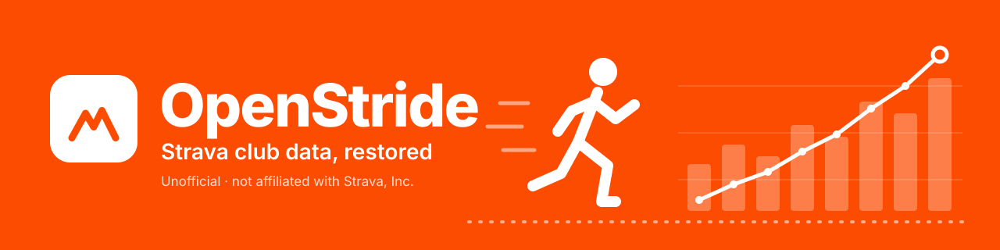

<p align="center">
  
</p>

> **Unofficial. For educational purposes only.**
> OpenStride is not affiliated with, endorsed by or sponsored by Strava, Inc. "Strava" is a
> trademark of Strava, Inc. Review Strava's Terms of Service before use: using OpenStride
> may get the account you log in with restricted or banned. You are responsible for how you
> use OpenStride and for the club members' data it returns. Only use it with clubs you
> belong to, keep the request rate low, and respect members' privacy choices.

## Why OpenStride exists

Running and cycling clubs on Strava rely on club data for leaderboards, challenges and member lists. On
**1 September 2026**, Strava removed the three API endpoints that provided it:

- `GET /clubs/{id}/activities`
- `GET /clubs/{id}/members`
- `GET /clubs/{id}/admins`

Club tools built on those endpoints stopped working.

**OpenStride brings that data back.** It reads the club the way you see it on strava.com, through your
own logged-in session, and returns it in the same shape the API used to. It also adds fields the API
never had, such as activity ids, dates and full names. For everything else in Strava's API, it builds on
[stravalib](https://github.com/stravalib/stravalib).

## The three components

| | Component | What it gives you | Use it when you want to... |
|---|---|---|---|
| **1** | **Library** (`pip install openstride`) | A Python package and the `openstride` CLI. `Client` is a drop-in `stravalib.Client` with the three club methods working again. `ClubScraper` works without an API token. | ...fetch club data from your own scripts or apps |
| **2** | **Dashboard** (`python -m dashboard serve`) | A self-hosted club challenge page: totals, awards, a leaderboard of every member, history and trends. It syncs with Strava every hour, stores CSV files, and serves the removed endpoints again at `/api/v3/clubs/...`. | ...run a club challenge page on your own machine |
| **3** | **Docker** (`docker compose up -d`) | The dashboard in a container that's always on, with Chromium included, automatic restarts and a health check. It keeps the page close to real time. | ...host the dashboard on a server and leave it running |

Each component builds on the one before it: the dashboard uses the library, and Docker packages the
dashboard.

## Quick start

```bash
pip install openstride
python -m playwright install chromium
openstride login                 # log in to Strava in the window that opens
openstride activities 123456     # your club's recent activities as JSON
```

```python
from openstride import Client

with Client(session_file="auth_state.json") as client:
    for a in client.get_club_activities(123456):
        print(a.athlete.name, a.sport_type, a.distance, a.start_date)
```

You'll need Python 3.14+, a Strava account in the club, and Strava's display language set to English.

## Documentation

| Component | For users | For developers |
|---|---|---|
| Library | [README](https://github.com/choonyongchan/OpenStride/blob/main/docs/library/README.md) | [Developer guide](https://github.com/choonyongchan/OpenStride/blob/main/docs/library/DeveloperGuide.md) |
| Dashboard | [README](https://github.com/choonyongchan/OpenStride/blob/main/docs/dashboard/README.md) | [Developer guide](https://github.com/choonyongchan/OpenStride/blob/main/docs/dashboard/DeveloperGuide.md) |
| Docker | [README](https://github.com/choonyongchan/OpenStride/blob/main/docs/docker/README.md) | [Developer guide](https://github.com/choonyongchan/OpenStride/blob/main/docs/docker/DeveloperGuide.md) |

## Licence

MIT. Builds on [stravalib](https://github.com/stravalib/stravalib) (Apache-2.0) and
[Playwright](https://playwright.dev/). Dashboard originally based on
[DatabenderSK/strava-club-dashboard](https://github.com/DatabenderSK/strava-club-dashboard).
